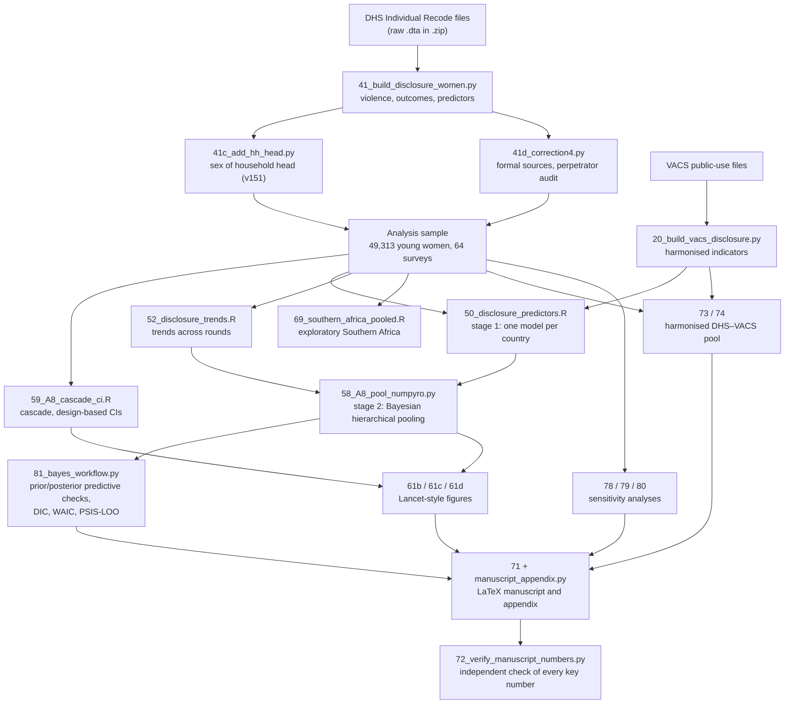
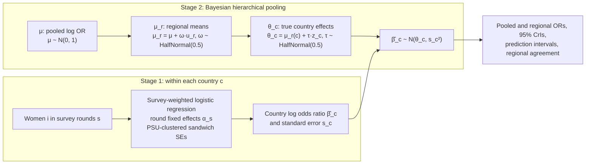
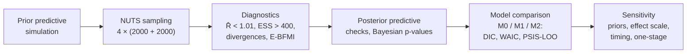
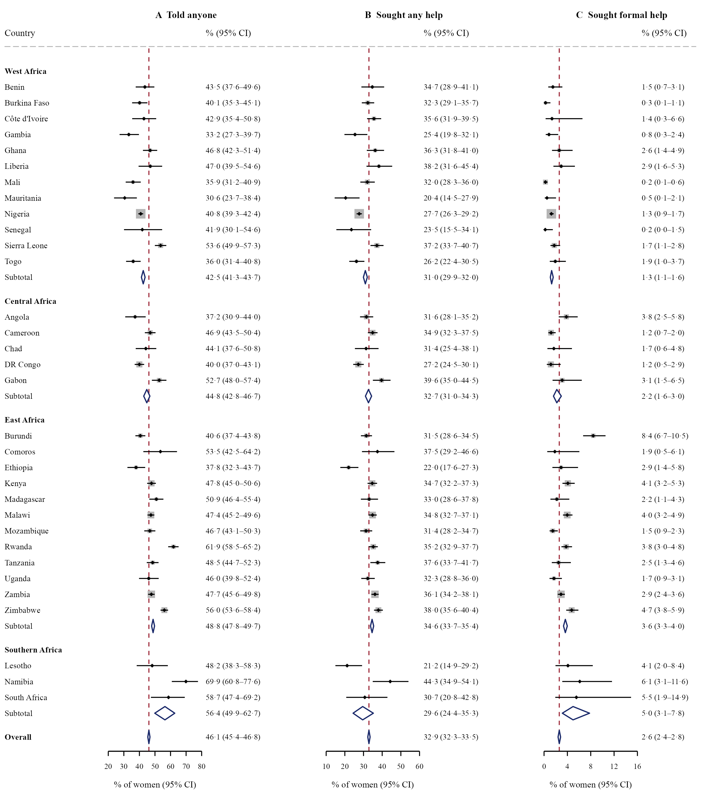
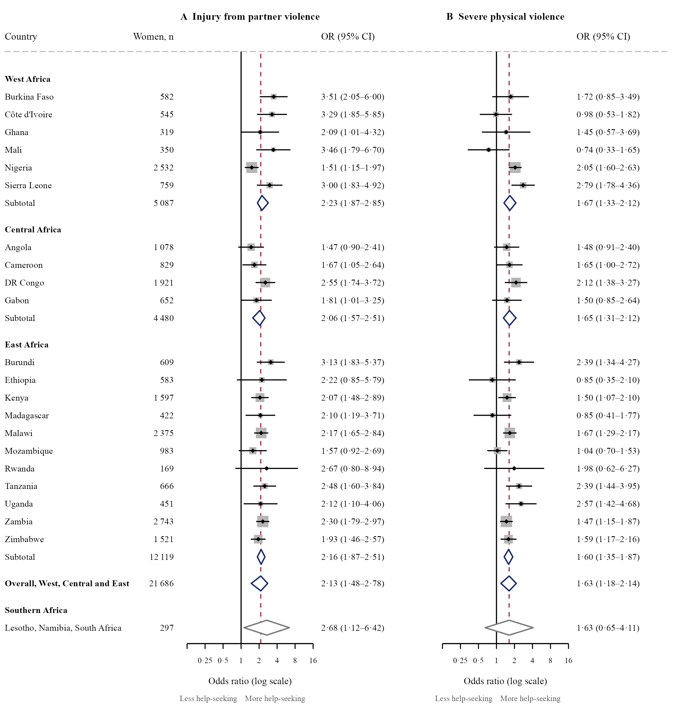
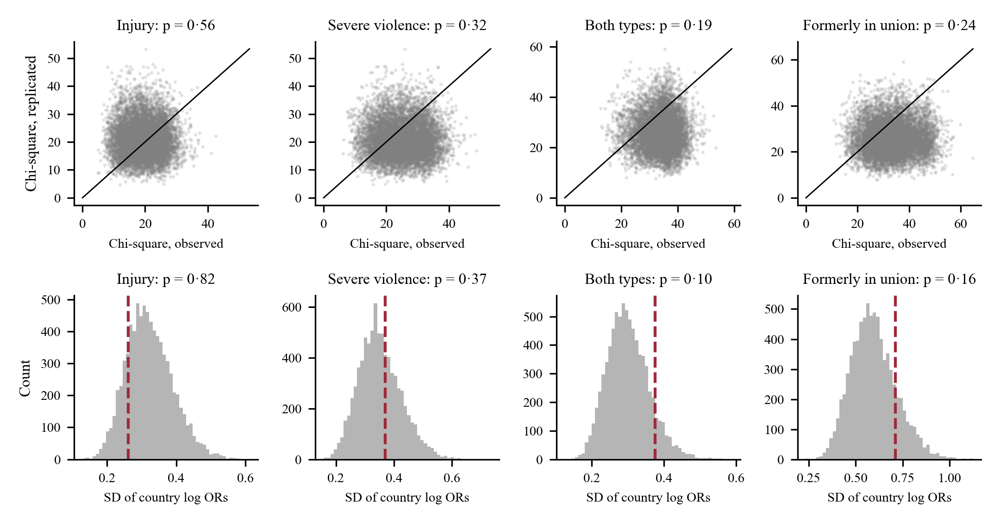

# Help-seeking after violence among adolescents and young people in sub-Saharan Africa

Code for a multi-country analysis of disclosure and help-seeking after physical and sexual violence among young people aged 13–24 years,
using **64 Demographic and Health Surveys (DHS) from 32 countries** and **eight Violence Against Children and Youth Surveys (VACS)**.

> **Status:** manuscript in preparation (Oxford Martin Programme on Climate and Child Health / Accelerate Hub, University of Oxford).
> Results below are from the current pre-registered analysis and may change before publication. The survey data are **not** included (see [Data](#2-data)).

**Contents:** [1 Questions](#1-questions) · [2 Data](#2-data) · [3 Pipeline](#3-analysis-pipeline) · [4 Model](#4-model-construction) · [5 Results](#5-results) · [6 Reproduce](#6-repository-structure-and-how-to-reproduce) · [7 Pre-registration](#7-pre-registration) · [8 Software](#8-software)

---

## 1. Questions

1. How many young survivors tell someone, seek help and reach formal services, and how does this differ across African regions?
2. Which factors are associated with help-seeking, and are they the same across regions?
3. Is help-seeking among young people changing over time?
4. Do DHS and VACS agree, and can their associations be pooled?

## 2. Data

| | DHS | VACS |
|---|---|---|
| Respondents | 49,313 women aged 15–24 years who reported physical or sexual violence | 48,910 girls and boys aged 13–24 years (16,238 reported violence) |
| Coverage | 64 surveys, 32 countries, 2004–2025, West, Central, East and Southern Africa | 8 countries, one round each, 2013–2023, East and Southern Africa |
| Violence | physical since age 15; sexual by partners and others | sexual and physical asked separately |
| Help-seeking | told anyone; sought help and from whom (lifetime) | told; knew where to get help; sought help; received services (lifetime) |
| Weights | domestic violence module weight `d005/1e6` (sums to sample size) | expansion weights, normalised within country |
| Role in the analysis | cascade, factors, regional comparison, replication, trends | girls vs boys; sexual vs physical violence; ages 13–14 |

Percentages are **never pooled across surveys**; associations are pooled only in a pre-specified harmonised analysis (§4.4).

**Data access.** DHS data are available from the [DHS Program](https://dhsprogram.com) on registration (Individual Recode files, `*IR*DT.zip`).
VACS public-use data are available from Together for Girls and the US CDC. The licences do not allow redistribution, so this repository contains code only.

## 3. Analysis pipeline

## 4. Model construction

### 4.1 Two-stage individual participant data design

### 4.2 Equations

Survey-weighted proportion with a logit-scale 95% CI (Taylor linearisation, PSU clustering):

$$\hat p=\frac{\sum_i w_i y_i}{\sum_i w_i},\qquad \operatorname{logit}(\hat p)\pm 1.96\,\frac{\widehat{\mathrm{SE}}(\hat p)}{\hat p(1-\hat p)}$$

Stage 1, country model for woman *i* in survey round *s(i)*, fitted by weighted pseudo-likelihood with cluster-robust standard errors:

$$\operatorname{logit}\Pr(Y_i=1\mid\mathbf x_i)=\alpha_{s(i)}+\mathbf x_i^{\top}\boldsymbol\beta_c,\qquad
\widehat{\mathbf V}(\hat{\boldsymbol\beta}_c)=\tfrac{G}{G-1}\mathbf A^{-1}\Big(\sum_g\mathbf u_g\mathbf u_g^{\top}\Big)\mathbf A^{-1}$$

Stage 2, countries within UN regions (non-centred):

$$\hat\beta_{ck}\sim\mathcal N(\theta_{ck},s_{ck}^2),\quad \theta_{ck}=\mu_{r(c)k}+\tau_k z_c,\quad \mu_{rk}=\mu_k+\omega_k u_r,\quad z_c,u_r\sim\mathcal N(0,1)$$

Approximate weight of country *c* in region *r* in the pooled estimate:

$$\lambda_c=\frac{W_r}{\sum_{r'}W_{r'}}\cdot\frac{w_c}{\sum_{c'\in r}w_{c'}},\qquad w_c=\frac{1}{s_c^2+\tau^2},\qquad W_r=\Big(\frac{1}{\sum_{c\in r}w_c}+\omega^2\Big)^{-1}$$

### 4.3 Priors and Bayesian workflow

| Parameter | Prior | Implication |
|---|---|---|
| μ (pooled log OR) | Normal(0, 1) | pooled OR between 0.14 and 7.1 with 95% prior probability |
| ω (between-region SD) | Half-Normal(0.5) | regional ORs may differ up to about 2.7-fold |
| τ (between-country SD) | Half-Normal(0.5) | as for ω |
| δ (DHS–VACS difference) | Normal(0, 1) | ratio of ORs between surveys within 0.14–7.1 |

M0 = common effect; M1 = countries exchangeable, no regional level; M2 = countries within regions (primary).

### 4.4 Harmonised DHS–VACS pooling

$$\theta_{jk}=\mu_k+\delta_k x_j+\omega_k u_{r(j)}+\tau_k z_j,\qquad x_j=-\tfrac12\ (\text{DHS}),\ +\tfrac12\ (\text{VACS})$$

exp(μ) is the pooled OR (programmes weighted equally), exp(μ ∓ δ/2) the DHS and VACS ORs, and exp(δ) their ratio; the surveys *agree* if the 95% CrI of exp(δ) includes 1 and both estimates share a sign with probability > 0.9.

## 5. Results

### 5.1 The disclosure cascade (DHS, young women 15–24 years)

| Step | All countries (sample-weighted) | Population-weighted | West | Central | East | Southern |
|---|---|---|---|---|---|---|
| Told anyone | 46.1% (45.4–46.8) | 44.0% | 42.5% | 44.8% | 48.8% | 56.4% |
| Sought any help | 32.9% (32.3–33.5) | 29.8% | 31.0% | 32.7% | 34.6% | 29.6% |
| Sought formal help | 2.6% (2.4–2.8) | 2.3% | 1.3% | 2.2% | 3.6% | 5.0% |

Help came mostly from family (80%), friends or neighbours (21%) and the partner's family (20%);
4.9% went to the police and 1.6% to a health worker.
In VACS, after sexual violence, 50.4% of girls and 33.9% of boys told someone, and 10.8% and 5.7% sought help.

### 5.2 Factors associated with seeking any help

Odds ratios (95% credible intervals) from the two-stage model; the last column is the 95% prediction interval for a new country.

| Factor | West | Central | East | Southern (exploratory) | All regions | Prediction interval |
|---|---|---|---|---|---|---|
| Injury from partner violence (vs none)ᵃ | 2.23 (1.87–2.85) | 2.06 (1.57–2.51) | 2.16 (1.87–2.51) | 2.68 (1.12–6.42) | **2.13 (1.48–2.78)** | 1.06–3.98 |
| Severe physical violence ᵃ | 1.67 (1.33–2.12) | 1.65 (1.31–2.12) | 1.60 (1.35–1.87) | 1.63 (0.65–4.11) | **1.63 (1.18–2.14)** | 0.81–3.16 |
| Physical and sexual violence (vs physical only) | 2.08 (1.79–2.48) | 1.97 (1.66–2.40) | 1.80 (1.58–2.05) | 1.42 (0.54–3.71) | **1.93 (1.41–2.58)** | 1.00–3.61 |
| Formerly in union (vs currently in union) | 1.72 (1.25–2.25) | 1.73 (1.24–2.33) | 1.79 (1.42–2.24) | 1.80 (0.25–12.98) | **1.73 (1.18–2.38)** | 0.68–4.15 |
| Partner drinks alcohol ᵃ | 1.25 (1.06–1.52) | 1.27 (1.06–1.59) | 1.13 (1.00–1.28) | 1.92 (0.77–4.79) | **1.21 (0.92–1.63)** | 0.68–2.26 |
| Currently working | 1.22 (1.10–1.35) | 1.21 (1.07–1.40) | 1.16 (1.06–1.26) | 1.11 (0.55–2.23) | **1.19 (0.98–1.48)** | 0.78–1.82 |
| Secondary or higher education (vs none) | 1.19 (0.94–1.52) | 1.18 (0.88–1.66) | 1.13 (0.88–1.43) | 2.81 (0.33–24.15) | **1.16 (0.84–1.61)** | 0.45–2.90 |
| Household wealth (per quintile) | 1.00 (0.95–1.06) | 0.99 (0.92–1.05) | 0.99 (0.94–1.02) | 1.06 (0.83–1.35) | **0.99 (0.88–1.11)** | 0.77–1.28 |
| Urban residence (vs rural) | 1.06 (0.91–1.25) | 1.28 (1.03–1.64) | 1.05 (0.91–1.21) | 0.67 (0.33–1.33) | **1.12 (0.78–1.62)** | 0.54–2.34 |

ᵃ Among women with partner violence. Southern Africa: one pooled model of Lesotho, Namibia and South Africa (95% CI), not part of "all regions".
Injury, severe violence and both types of violence **replicated in two independent random halves of countries**; wealth, education and urban residence were null
in crude, fully adjusted and reduced socio-demographic models.

### 5.3 Robustness of the four main factors

| Analysis | Injury | Severe violence | Both types | Formerly in union |
|---|---|---|---|---|
| Primary (two-stage, Bayesian) | 2.13 (1.48–2.78) | 1.63 (1.18–2.14) | 1.93 (1.41–2.58) | 1.73 (1.18–2.38) |
| Risk difference, percentage points | +15.8 (8.9 to 21.2) | +10.0 (3.2 to 16.2) | +14.3 (7.8 to 20.3) | +12.4 (3.3 to 20.1) |
| Prevalence ratio | 1.47 (1.18–1.76) | 1.28 (1.06–1.54) | 1.47 (1.16–1.86) | 1.37 (1.08–1.69) |
| Violence only in past 12 months | 2.22 (1.55–3.17) | 1.64 (1.13–2.27) | 1.84 (1.37–2.40) | 1.77 (1.11–2.58) |
| Crude | 2.92 (1.97–3.70) | 2.52 (1.69–3.38) | 2.03 (1.44–2.70) | 1.80 (1.22–2.35) |
| One-stage, survey-weighted | 2.08 (1.89–2.28) | 1.61 (1.46–1.77) | 1.90 (1.76–2.05) | 1.73 (1.53–1.96) |
| One-stage mixed model | 2.13 (1.94–2.32) | 1.64 (1.43–1.89) | 1.80 (1.66–1.95) | 1.79 (1.58–2.02) |

### 5.4 Pooling DHS and VACS (young women and girls 15–24 years)

| Outcome · factor | DHS | VACS | Ratio VACS/DHS | Pooled | Surveys |
|---|---|---|---|---|---|
| Sought help · both types of violence | 2.00 (1.59–2.48) | 2.28 (1.67–3.10) | 1.14 (0.87–1.50) | 2.14 (1.69–2.66) | agree |
| Told anyone · both types of violence | 1.98 (1.51–2.45) | 3.64 (2.71–4.84) | 1.85 (1.49–2.31) | 2.69 (2.07–3.39) | differ |
| Told anyone · female household head | 1.20 (1.01–1.41) | 1.14 (0.94–1.45) | 0.96 (0.80–1.19) | 1.17 (1.00–1.40) | agree |
| Sought help · female household head | 1.13 (0.97–1.33) | 1.06 (0.81–1.36) | 0.93 (0.73–1.19) | 1.10 (0.92–1.31) | uncertain |

### 5.5 Change over time

Odds ratio per decade, adjusted: sought any help 0.73 (0.54–1.02); told anyone 0.74 (0.49–1.14); formal help 1.13 (0.54–2.00).
Restricted to DHS phase 6 or later, the decline in seeking any help was 0.69 (0.50–0.96).

### 5.6 Model checking

* **Prior predictive:** OR for a new country 95% range 0.09–10.38.
* **Posterior predictive:** the common-effect model M0 misfitted for 7 of 13 factors (Bayesian p < 0.05); the primary model M2 reproduced every discrepancy (p_B 0.07–0.95) except the largest estimate for both types of violence (Togo; excluding it, 1.88 (1.42–2.39)).
* **Model comparison:** M1 (no regions) was marginally better than M2 in 5 of 26 comparisons (Δelpd ≤ 1.1, below the threshold of 4 for a meaningful difference); M2 was kept because regional comparison is a study question.
* **Computation:** R̂ ≤ 1.003; E-BFMI ≥ 0.57. Pooled estimates were reproduced independently with **brms/Stan** (`methods_walkthrough/75_disclosure_walkthrough_brms.Rmd`).

## 6. Repository structure and how to reproduce

| Folder | Scripts | Purpose |
|---|---|---|
| `build/` | `41_build_disclosure_women.py` (run with and without `--heldout`), `41c_add_hh_head.py`, `20_build_vacs_disclosure.py` | raw DHS/VACS files → analysis files |
| `review/` | `41d_correction4.py` | coding audit of help sources and perpetrator (run after `build/`) |
| `analysis/` | `50_disclosure_predictors.R` (env `P33_SCOPE=youth AGE_CONT=1`), `52_disclosure_trends.R`, `59_A8_cascade_ci.R`, `69_southern_africa_pooled.R`, `57_A8_victimisation_trend.R` | stage 1 models, cascade, trends |
| `pooling/` | `pool_numpyro.py`, `58_A8_pool_numpyro.py` | stage 2 Bayesian pooling (NumPyro) |
| `harmonised/` | `73_p37_country_models.R`, `74_p37_pool.py` | DHS–VACS pooling |
| `review/` | `78_review_country_models.R`, `79_review_pool.py`, `80_population_weights.R`, `81_bayes_workflow.py` | sensitivity analyses and Bayesian workflow |
| `figures/` | `61b`, `61c`, `61d` | figures |
| `manuscript/` | `71_build_latex_manuscript.py`, `manuscript_appendix.py`, `72_verify_manuscript_numbers.py` | manuscript, appendix, independent number check |
| `methods_walkthrough/` | `76_step_by_step_guide_codes_weights.Rmd`, `75_disclosure_walkthrough_brms.Rmd` | teaching versions: survey codes and weights; the full analysis in tidyverse + brms |

Paths assume the project folder `~/Documents/OMS DHS Births Climate Policy` with the DHS files in `data/raw/dhs_ir/`; edit `ROOT` at the top of each script to use another location.

## 7. Pre-registration

Every analysis plan, amendment and result was written and hashed (SHA-256) before the analysis it describes was run.
The documents will be released with the paper; the time stamps and hashes below allow them to be checked then.

| Time stamp | SHA-256 (first 16) | Stage |
|---|---|---|
| 2026-10-21 09:16 | `e61fb4ccae48d1f0` | PREREGISTRATION 33 disclosure predictors regional.md (before models) |
| 2026-10-21 09:19 | `21396b850eb5a97b` | PREREGISTRATION 33 implementation notes (before models) |
| 2026-10-21 09:24 | `b65243f43a62fe87` | PREREGISTRATION 33 correction (dm na bug) + post-hoc sensitivity declared |
| 2026-10-21 09:25 | `a83f23bf8204cab5` | PREREGISTRATION 33 results appended |
| 2026-10-21 15:48 | `9cdbce5f684a10af` | PREREGISTRATION 33 amendment A5 (trends across rounds; before models) |
| 2026-10-21 15:50 | `cd7533cbe6146e9a` | PREREGISTRATION 33 correction 2 (told/d128, SN 2019 n=1; before re-run) |
| 2026-10-21 15:52 | `ae990f9291f05c35` | PREREGISTRATION 33 correction 2 addendum (informative-d128 rule; before re-run) |
| 2026-10-21 15:52 | `35b86621f446c3b1` | PREREGISTRATION 33 correction 2 addendum final (<1% rule, 8 surveys; before re-run) |
| 2026-10-21 15:55 | `d37e11680cc81507` | PREREGISTRATION 33 corrected results + A5 results appended |
| 2026-10-21 16:27 | `df8d3d7c7b818da1` | PREREGISTRATION 33 amendment A6 youth 15-24 (before youth models) |
| 2026-10-21 16:29 | `cbad73b6c197f26f` | PREREGISTRATION 33 A6 youth results appended |
| 2026-10-23 10:00 | `11a1467310270dcf` | PREREGISTRATION 33 amendment A8 co-author review analyses (before runs) |
| 2026-10-23 10:04 | `33736bc52b3eedc7` | PREREGISTRATION 33 A8.4 sampler note |
| 2026-10-23 10:05 | `8d1f23ae753cd03f` | PREREGISTRATION 33 A8.6 infeasible note |
| 2026-10-23 10:18 | `888e8144cf0c409a` | PREREGISTRATION 33 A8.2-A8.5 results |
| 2026-10-26 08:01 | `af780c28e293fe32` | PREREGISTRATION 33 exploratory Southern Africa pooled model (before run) |
| 2026-10-27 16:06 | `189f5c269dfd62e3` | PREREGISTRATION 33 Correction 3 (VACS Kenya formula bug; results appended) |
| 2026-10-27 16:18 | `f56681a4bc6ec011` | PREREGISTRATION 37 harmonised DHS-VACS pool (before models) |
| 2026-10-27 16:20 | `d3dab35595ddd37c` | PREREGISTRATION 37 results appended |
| 2026-10-28 12:55 | `83bd01d22f5cd3fc` | PREREGISTRATION 38 Correction 4 + review sensitivity analyses (before running) |
| 2026-10-28 13:09 | `9ac28837ea371182` | PREREGISTRATION 38 addendum B12 Bayesian workflow (before running) |
| 2026-10-28 13:17 | `52126dc581581da7` | PREREGISTRATION 38 results and deviations appended |

## 8. Software

R 4.5 (survey, fixest, data.table, lme4, car, brms, cmdstanr, tidyverse) · Python 3 (pandas, NumPyro, JAX, ArviZ, PyMuPDF).
Bayesian sampling: No-U-Turn sampler, 4 chains × (2000 warm-up + 2000 draws), seed 20261023, target acceptance 0.995.

---
*Contact: Samuel Tekle, University of Oxford. Please cite the paper once published.*
